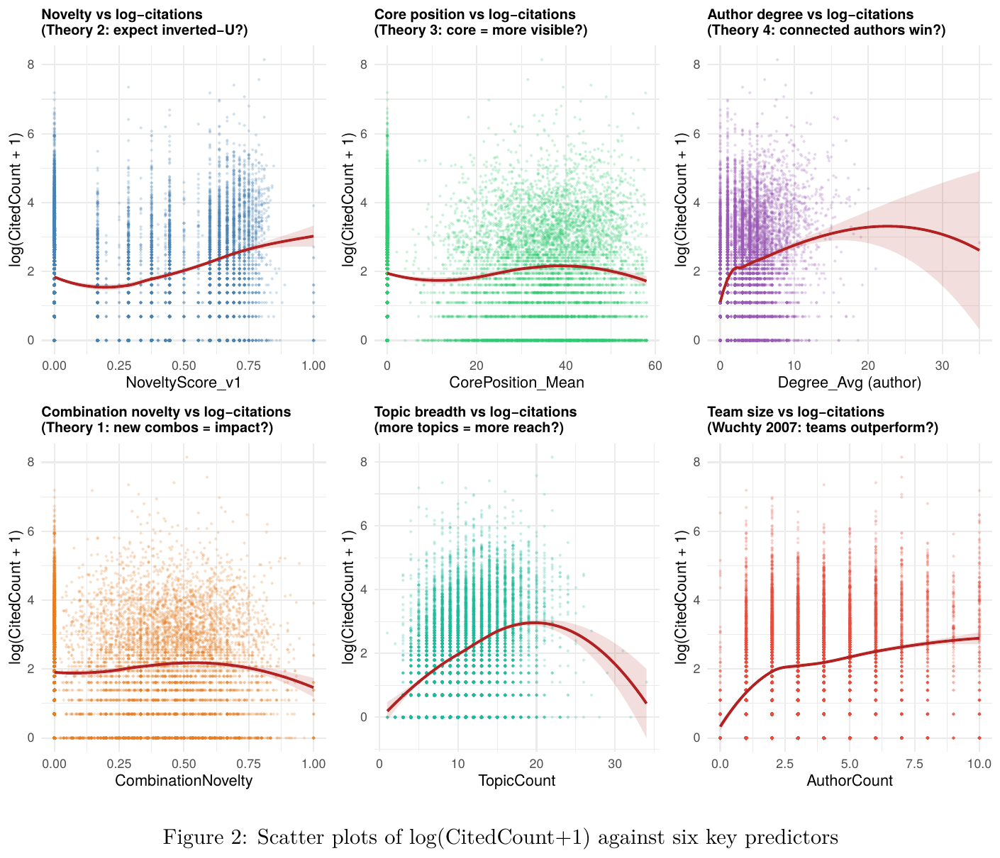
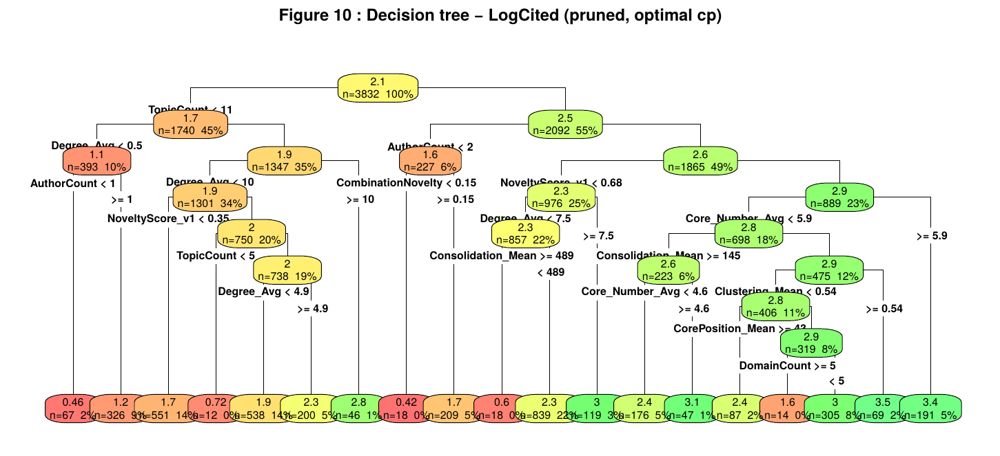
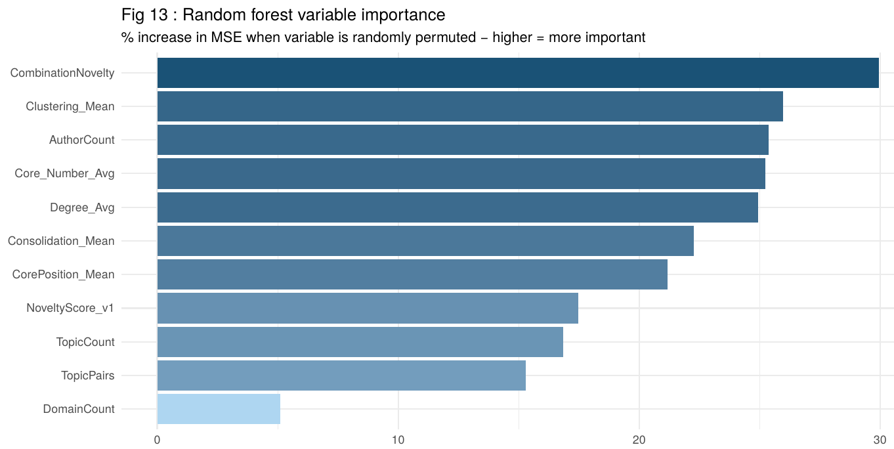
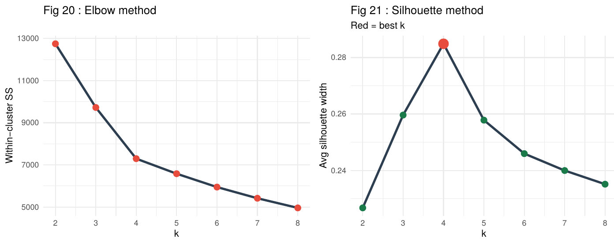
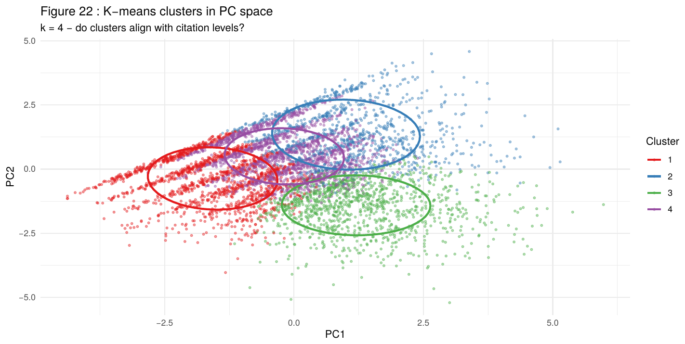
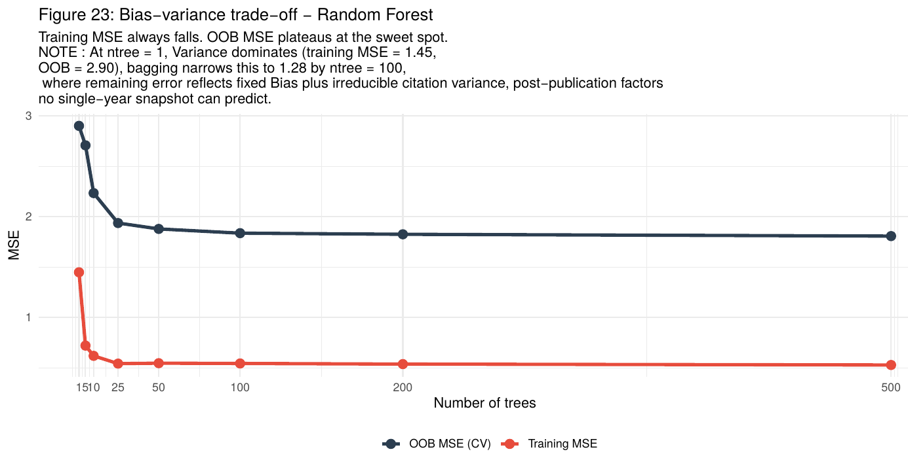
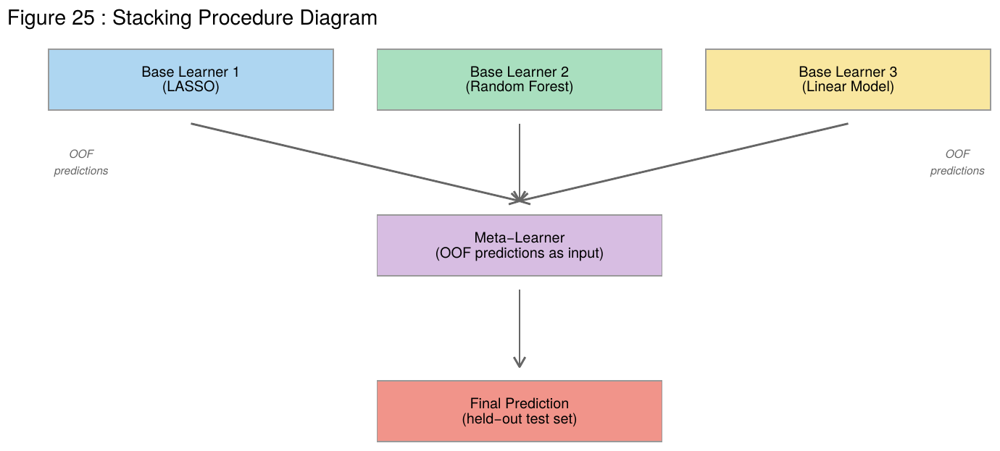

# Predicting the Citation Impact of Biomedical Research

**MSc Business Analytics: Advanced Analytics and Machine Learning, Assignment 2 (2026)**
**Author:** Ria Goel  ·  **Tools:** R Markdown · glmnet · rpart · randomForest · pdp · caret · cluster · ggplot2 · gt

> Most scientific papers are rarely cited, while a few shape whole fields. Using **10,972 PubMed records (1990–91)**, this project tests **what predicts citation impact**: novelty, position in knowledge networks, topic breadth or team size. It uses LASSO, tree-based models, PCA with clustering, and a stacked ensemble.

---

## Key results at a glance

| | Result |
|---|---|
| **Best model** | **Stacked ensemble** (LASSO + random forest + linear model): lowest test MSE, **1.8665** |
| **Random forest vs single tree** | RF CV-MSE **1.808** vs 1.838 for the tree, and test MSE 1.912 vs 1.945 |
| **Most robust predictor** | **TopicCount** (how many topics a paper covers): kept by LASSO, the tree's first split (at 11 topics), and diminishing returns above about 20 |
| **Team size** | Impact rises up to about 5–7 authors, then flattens |
| **Clusters** | "High-novelty, well-connected" papers have the highest impact: **71% above-median** vs 47–53% in other clusters |
| **Data diagnostics** | About 50% **structural zeros** (measures that can't be calculated for those papers) were found and handled with a two-track design |

---

## Theory being tested
- **Fleming (2001):** combining distant ideas.
- **Burt (2004):** position within knowledge networks.
- **Wuchty et al. (2007):** the rise of team science.
- **Uzzi et al. (2013):** atypical combinations of ideas, with an expected inverted-U relationship to impact.

## Approach

### Data diagnostics
- **Structural zeros:** about 50% of records have zeros on the novelty and network measures. All 1990 papers lack a previous-year corpus to compare against, and single-topic papers have no concept pairs. These zeros mean "can't be calculated", not "no novelty".
- **Two tracks:** `df_full` (10,972 rows) is used for descriptive analysis, and `df_active` (5,474 rows) for models that use the novelty and network measures.
- **Dropped or flagged columns:** two columns were zero for every record and were dropped. The three novelty versions are perfectly correlated (r = 1.00).



### Part 1: LASSO
- 10-fold CV (min CV-MSE **1.806**) kept 5 of 16 predictors.
- Splitting by subgroup showed that citations for interdisciplinary papers are harder to predict (CV-MSE 1.848 vs 1.757 for single-domain papers).

### Part 2: Tree-based models

| Model | 10-fold CV-MSE | Test MSE |
|---|---|---|
| Decision tree (pruned, 18 splits) | 1.838 | 1.945 |
| **Random forest** (500 trees, 2 variables per split, tuned on out-of-bag error) | **1.808** | **1.912** |
| LASSO (reference) | 1.806 | – |



The tree splits first on **TopicCount at 11**, then on author connectivity, then on team size. The random forest variable importance ranks **CombinationNovelty**, **Clustering_Mean** and **AuthorCount** highest. These measures add independent signal once topic breadth is accounted for.



### Part 3: PCA and k-means clustering
- **PCA** on five network variables: the first two components explain **80% of the variance**. PC1 reflects overall "knowledge integration". PC2 contrasts papers in dense knowledge areas with papers by well-connected authors.
- **k-means** (k = 4, chosen by silhouette score): the "high-novelty, well-connected" cluster stands out (ANOVA p < 2e-16).

 

### Part 4: Bias-variance trade-off and stacking
- **Bias-variance:** out-of-bag error levels off after about 100 trees. Between 1 and 10 trees, results vary a lot from run to run (high variance).
- **Polynomial terms for TopicCount:** returns diminish (AIC falls from 19,258 to 19,188).
- **Stacked ensemble:** built on **out-of-fold predictions**, so the combining model never sees data the base models were trained on (no leakage). The combining model gave weights of RF 0.47, LM 0.46 and LASSO 0.08.

| Model | Test MSE |
|---|---|
| LASSO | 1.8908 |
| Linear model | 1.8904 |
| Random forest | 1.9103 |
| **Stacked ensemble** | **1.8665** |

 

## Conclusion
- **Topic breadth and team size** are the most consistent predictors of citation impact.
- **Novelty adds value only when combined with author connectivity.**
- The inverted-U pattern predicted by Uzzi et al. (2013) was not found in this early corpus.
- **Limitations:** all modelled records come from a single year (so time-ordered cross-validation wasn't possible), and the bridging measures are missing.

## Repository structure
```
├── README.md
├── code/
│   └── citation_impact_analysis.Rmd   # Full analysis: diagnostics → LASSO → trees/RF → PCA/k-means → stacking
├── figures/                           # Key figures from the knitted report
└── report/
    └── Citation_Impact_Report.pdf     # Full knitted report (30 pages)
```

## How to run
The analysis is a reproducible R Markdown document with a fixed random seed. The dataset was provided by the module team and is not redistributed here. Place the CSV named in the `DATA_PATH` line in the same folder, then **Knit**.

## Skills demonstrated
`R` · `R Markdown` · `LASSO` · `decision trees` · `random forest` · `hyperparameter tuning` · `variable importance` · `partial dependence` · `PCA` · `k-means clustering` · `silhouette analysis` · `bias-variance trade-off` · `polynomial regression` · `stacked ensembles` · `cross-validation` · `data diagnostics`

---

*Related project from the same module: [Predicting star researchers in collaboration networks](https://github.com/riagoel11/star-researcher-prediction-ml-r)*

*GenAI was used to assist with debugging, structuring the stacking loop and formatting tables, as declared in the report. All modelling decisions and interpretations are the author's own.*
